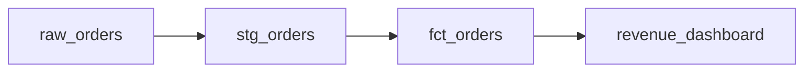

# Explain a pipeline

## Steps

1. Find how the table is produced: a dbt model (`models/**/<name>.sql`), a scheduled query, or a script. Search the repo with `grep -rn "<table name>"`.
2. Walk upstream: for dbt, follow `ref()` and `source()`; for plain SQL, the tables in `FROM` and `JOIN` (`dataskill check --json <file>` lists them under `tables`).
3. Walk downstream: every file that reads this table.
4. Draw the lineage as a Mermaid diagram, upstream on the left:

5. Under the diagram, one line per node: what it does, where it lives (file path), and how often it runs if known.

## Never

Invent a node. Every node must link to a file you read or a table in `.dataskill/SCHEMA.md`; mark anything inferred as "(inferred)".

## Done when

Every node in the diagram has a file path or a schema-memory entry, and the downstream list is complete for the repo.
